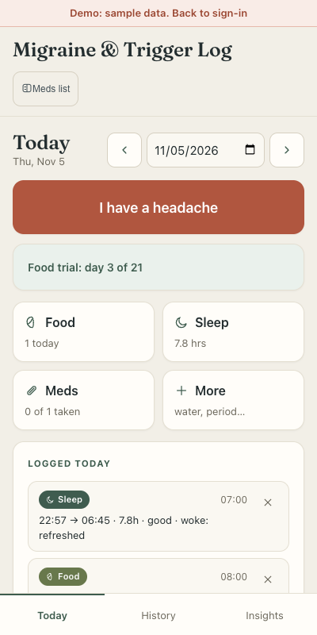
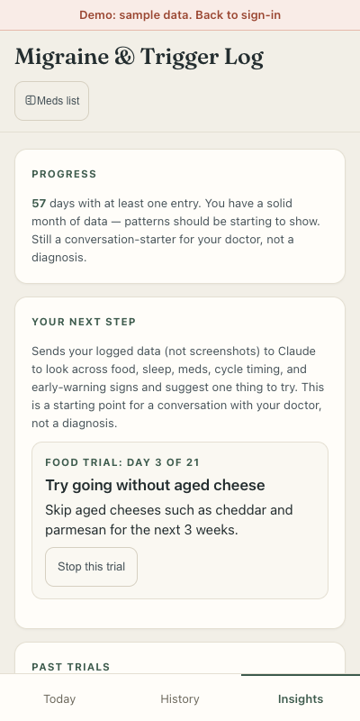
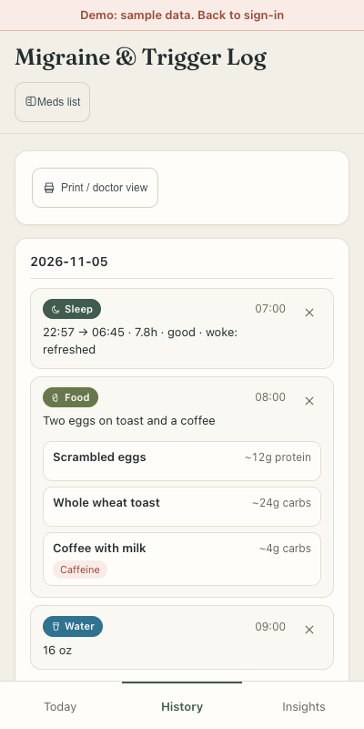

# Migraine Tracker

A small web app for people with migraines to log what they eat, how they sleep, what medication they take and when headaches happen, then see which of those things tend to come before a headache.

It was built for a few invited family and friends, not for public sign-up. It is not a medical device. It does not diagnose anything and it does not give medication advice. It points out patterns worth raising with a doctor.

**Live site and demo:** _link added after deployment_

The "View demo" button on the sign-in screen opens the app with made-up sample data. It needs no account and sends nothing anywhere. The screenshots below show that fictional data, not a real person's log.

| Today | Insights | History |
| --- | --- | --- |
|  |  |  |

## Features

- Log meals, sleep, activity, medication and headaches (with start and end times, so an attack that crosses midnight counts once).
- Paste a meal description and have it split into individual foods. Read a nutrition, sleep or workout screenshot into form fields.
- Insights: one concrete thing to try next, other factors being watched, what to keep logging, and questions for a doctor.
- Trials: start a suggestion, and the app counts the days and notes that one trial cannot prove cause.
- History view, and a demo mode with sample data.

## Architecture

- **Front end:** static HTML, CSS and plain ES modules in `public/`. No framework, no build step, no front-end packages.
- **One Netlify function:** `netlify/functions/ai.js` is the only server code. It is the only thing that talks to Claude (`claude-sonnet-5-5` for analysis and screenshots, `claude-haiku-5-5` for splitting food text).
- **Supabase:** Postgres and email/password auth. The browser reads and writes entries directly. Row-level security limits every table to the signed-in user's own rows.
- The only runtime dependency is `@anthropic-ai/sdk`.

## Security

- The Anthropic API key exists only as a server environment variable (`ANTHROPIC_API_KEY`). It is never sent to the browser.
- The function checks the caller's Supabase session on every request and rejects anything else with 401.
- Daily limits per user and per action are enforced in Postgres by a `consume_ai_quota` function that reads `auth.uid()`, not in the browser.
- The browser sends only an action name and data. It cannot choose the prompt, the model or the token limits; the server sets those. Requests are validated and image uploads are size-capped.
- Accounts are invite-only: public sign-ups are disabled in Supabase and the owner creates accounts.
- A Content-Security-Policy and other headers are set in `netlify.toml`. User and AI text is rendered with `textContent` or escaping.
- Server logs hold labels only, never entry content.
- The Supabase project URL and anon key in `netlify/functions/lib/config.js` and `public/js/app.js` are public by design; they grant nothing without row-level security.

## How Insights works

1. A statistics engine (`public/js/patterns.js`) does the analysis. For each food or sleep factor it compares the 48 hours before each headache with headache-free two-day stretches, counting only days that were actually logged.
2. It scores each factor with a one-sided Fisher exact test. Because testing many factors finds false leads, it applies multiple-comparison correction (Bonferroni for "strong", Benjamini-Hochberg for "moderate"). Repeated exposures (several days of eating the same thing) and runs of nearby attacks are grouped, so they are not counted as independent evidence.
3. Claude is given those numbers and asked to explain them in plain language. It does not do the statistics.
4. A safety validator (`netlify/functions/lib/insight.js`) checks the answer: allowed confidence levels, a trial length of 7 to 28 days, no medicines in the suggestion, and no cutting of a macronutrient or a whole food group. It uses text patterns, so it catches common wordings, not every wording. Only the confidence label is tied to the numbers: the engine's label replaces Claude's. Claude's explanation and any counts it quotes are not checked against the evidence. The medication note always comes from the engine, never from Claude, and a doctor question that gives an order is dropped.
5. If Claude fails, times out, breaks a rule or repeats a trial that did not help, a rule-based suggestion built from the same numbers is returned instead, so a result always appears.

## Tests

```
npm test
```

This runs the tests with Node's built-in test runner (no test dependencies). They cover the statistics engine, the validators, the function handler with a stubbed Claude client, the demo data, the schema and colour contrast.

## Run it yourself

Requires Node 24.

1. `npm install`
2. Create a Supabase project and run `supabase/schema.sql` in its SQL editor (this is yours to run; it creates the tables, row-level security policies and quota function). Turn off public sign-ups and add accounts by hand.
3. Replace `SUPABASE_URL` and `SUPABASE_ANON_KEY` in `netlify/functions/lib/config.js` and in `public/js/app.js` (lines 11 and 12), and the Supabase host in the `connect-src` of `netlify.toml`, with your own.
4. Set `ANTHROPIC_API_KEY` as an environment variable in Netlify (or your shell for local runs).
5. Serve `public/` with any static server to try the demo (`cd public && python3 -m http.server`). For the full app including the function, use `netlify dev`.

## Layout

```
public/              static front end (js/ modules, css/, index.html)
netlify/functions/   ai.js handler and lib/ (auth, quota, prompts, validation)
supabase/schema.sql  tables, row-level security, quota function
tests/               node:test suites
docs/screenshots/    demo screenshots (sample data)
docs/superpowers/    the design spec and plan the work was built from
```
